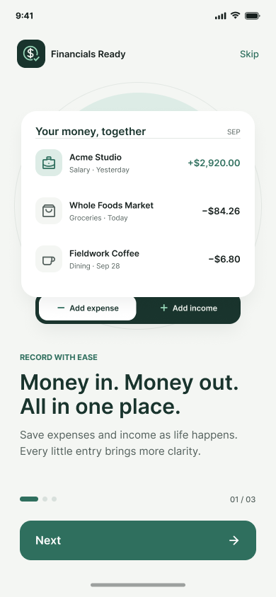
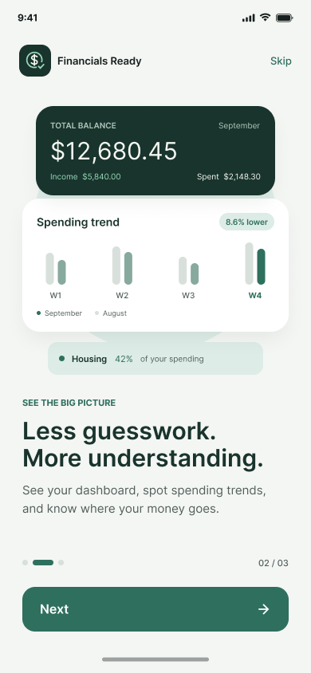
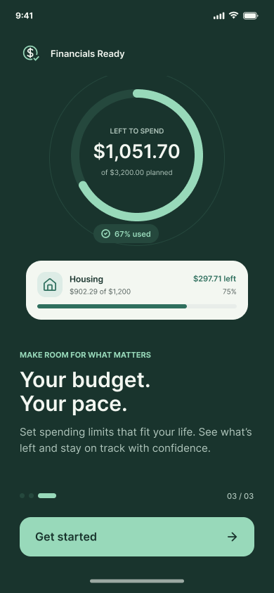
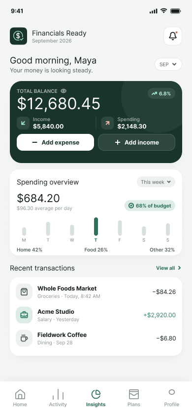
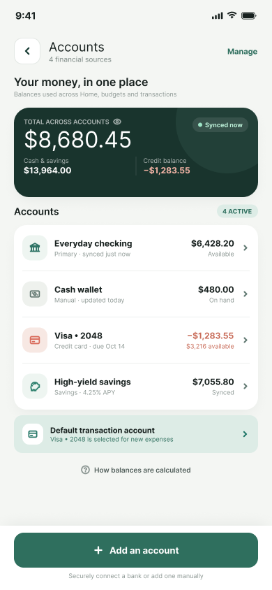
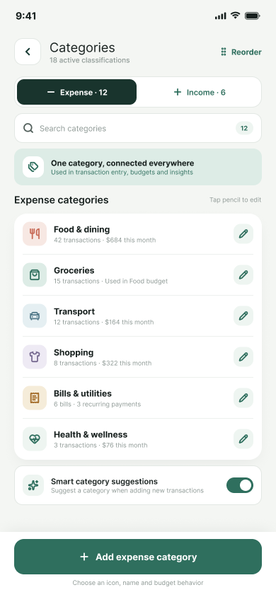
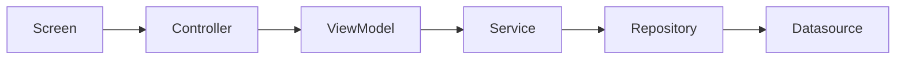

# Financials Ready

Personal finance app built with **Expo** and **React Native**. Track balances, record income and expenses, review activity, explore insights, set category budgets, and manage accounts. All from a clean, mobile-first UI.


## Demo & design

- **Figma** (screens designed here): [Mobile Financials Ready App](https://www.figma.com/design/oEcDf7bYD1nHFQaqTg5sMX/-shareable-Mobile_financials_Ready_App?node-id=26-4)
- **Walkthrough video**: [financy_ready.mp4 (Google Drive)](https://drive.google.com/file/d/1DfnpT2tBiQlb23bnEpos0rfYnOWyLw_q/view?usp=sharing)


## Screenshots


| Splash                                   | Onboarding                                    |
| ---------------------------------------- | --------------------------------------------- |
|  |  |


| Onboarding                                    | Onboarding                                    |
| --------------------------------------------- | --------------------------------------------- |
|  |  |


| Home                                                     | Accounts                                     |
| -------------------------------------------------------- | -------------------------------------------- |
|  |  |


| Categories                                       |
| ------------------------------------------------ |
|  |


More captures live under `[screenshots/](screenshots/)`.

## Features

- **Splash** - branded launch sequence
- **Onboarding** - three-step product intro (record, insights, budgets)
- **Home / Dashboard** - balance, spending overview, recent transactions
- **Activity** - filtered feed of transactions, account updates, and budget alerts
- **Insights** - cash flow, spending trends, and category breakdown
- **Plans / Budgets** - monthly budget overview, category progress, create budget modal
- **Profile** - preferences, accounts, and categories
- **Add transaction** & **Transaction details** - capture and review individual records

Data today is **in-memory mock** (no backend required to run the app).

## Stack

- [Expo](https://expo.dev) ~57 + [React Native](https://reactnative.dev)
- [Expo Router](https://docs.expo.dev/router/introduction/) (file-based navigation)
- TypeScript
- [Lucide React Native](https://lucide.dev) (icons)
- React Native Reanimated
- In-memory repositories / services (mock datasources)


## Architecture

The app follows **MVVM + Clean Architecture**, organized by **feature** under `src/features/<name>/`.

```
src/
  app/                 # Thin Expo Router routes (screens are imported from features)
  core/                # Shared theme, tokens, and utilities
  features/
    <feature>/
      domain/          # Entities (and use cases where needed)
      data/            # Datasources, repositories, services
      presentation/    # Screens, components, viewmodels, controllers
    shared/
      di.ts            # Composition root / dependency injection
```


### Layers


| Layer            | Responsibility                                                                                   |
| ---------------- | ------------------------------------------------------------------------------------------------ |
| **Presentation** | UI (`screens`, `components`), `viewmodels` (UI state), `controllers` (user intents / navigation) |
| **Domain**       | Entities and use cases, independent of frameworks                                                |
| **Data**         | Mock datasources, repository contracts + implementations, application services                   |


### Request flow




Services are wired once in `[src/features/shared/di.ts](src/features/shared/di.ts)` and imported by viewmodels/controllers. Swapping a mock repository for a real API client should not require rewriting screens.

### Feature modules (examples)

`dashboard`, `activity`, `insights`, `budget`, `profile`, `onboarding`, `add-transaction`, `transaction-details`, `splash`, plus shared transaction/store helpers.

## Getting started


### Prerequisites

- Node.js (LTS recommended)
- npm
- Expo Go, an emulator/simulator, or a [development build](https://docs.expo.dev/develop/development-builds/introduction/)


### Install & run

```bash
npm install
npx expo start
```

Then open the project in Expo Go, an Android emulator, an iOS simulator, or the web target from the CLI menu.

### Scripts


| Script                         | Description               |
| ------------------------------ | ------------------------- |
| `npm start` / `npx expo start` | Start the Expo dev server |
| `npm run android`              | Start targeting Android   |
| `npm run ios`                  | Start targeting iOS       |
| `npm run web`                  | Start targeting web       |
| `npm run lint`                 | Run Expo ESLint           |


Typecheck locally with:

```bash
npx tsc --noEmit
```


## Project structure (quick map)

```
FinancialsReady/
  src/app/             # Routes: tabs, modals (create-budget, add-transaction, …)
  src/core/            # Theme (colors, typography), formatters
  src/features/        # Feature slices (MVVM + Clean Architecture)
  screenshots/         # UI captures for docs
  assets/              # Images, fonts, tab icons
```


## Roadmap

- Integrate a backend API built with **NestJS** and **Firebase** (auth, persistence, sync).
- Replace in-memory repositories with HTTP/Firebase-backed implementations while keeping the same service/repository boundaries in `di.ts`.
- Persist onboarding completion and user session across launches.


## License

Private project (`"private": true` in `package.json`).